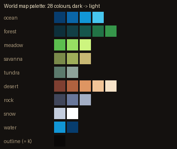
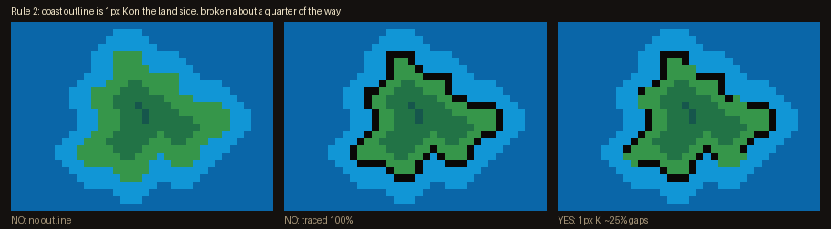
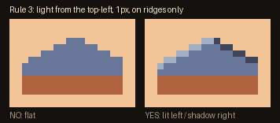
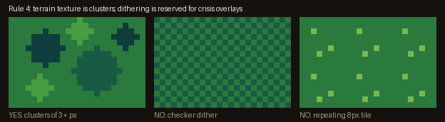
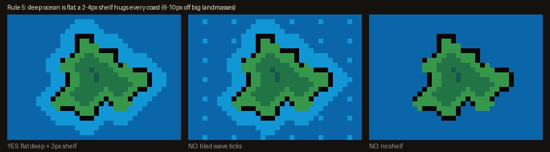
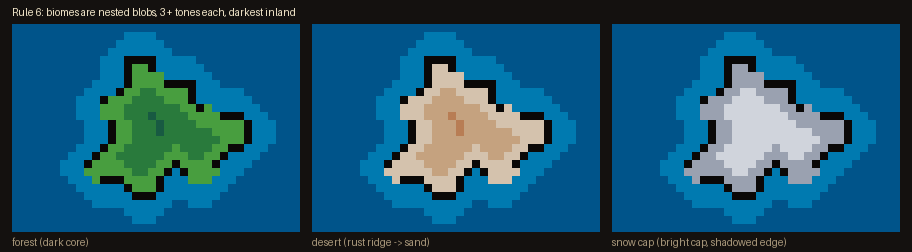
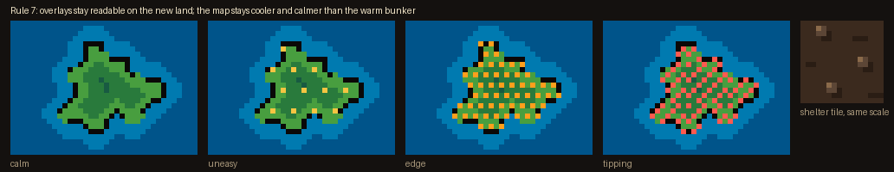

# Apocalypse Tycoon: pixel-art style guide

Live version, with every sprite rendered and animated: `demo/art-gallery.html`. Serve the repo root (for example with `python3 -m http.server`) and open it.

## Mood
Cozy-grim corporate satire. The world above is a muted, war-room map slowly catching fire. Below ground, the bunkers are warm and lit, with gold for the clients and plain steel for the things that actually keep them alive. The joke lives in that contrast.

## Palette: "Last Resort 28"
Defined once in `src/art/palette.js`. Sprites refer to colours by a one-character key, so no other colour can appear in art.

| Ramp | Keys (dark → light) | Use |
|---|---|---|
| Outline / UI neutrals | `K D d S W` | outlines, panels, text, paper |
| Earth | `e E B b` | the dig, desert |
| Metal | `k M m w` | bunker structure, machines, chrome |
| Gold | `y Y L` | luxury, cash, the player's brand |
| Green | `g G` | food, land, "safe" |
| Blue | `N n c C` | ocean, water, cryo |
| Crisis | `r R O` | heat, alarms, edge and tipping states |
| Accents | `V v T` | velvet and wine, neon (AI, grow lights), clean air |

Meaning is fixed: **gold = money/luxury, amber = edge, red = tipping/danger, mint = air, blue = water, green = food.** The HUD meters, map overlays and amenity accents all use the same colours for the same meanings.

## Grid and scale
- Shelter cells are **16×16**. A room is the `roomEmpty` tile with an amenity sprite drawn on top. Amenities rest on row 13, and rows 14–15 are floor.
- World-map terrain is painted per pixel on a 320×192 native canvas; the 40×24 grid of **8×8** cells is the region click grid (see "World map" below).
- UI icons are **12×12**, crisis icons **10×10**, and in-canvas text uses the **3×5** pixel font (`src/art/font.js`).
- Display only at **whole-number scales**. `fitIntegerScale()` picks the largest one that fits. Never use CSS stretching or smoothing (`image-rendering: pixelated`, `imageSmoothingEnabled = false`).

## Drawing rules
1. Light comes from the top-left: highlights on top and left edges, shadow on bottom and right.
2. Objects and icons get a 1px `K` outline. Terrain and room tiles don't.
3. Use at most 3–4 shades per material, picked from one ramp. No anti-aliasing and no single-pixel noise.
4. Terrain tiles must tile seamlessly in both directions.
5. Animation is 2 frames at 500 ms per frame (fans, cryo glow, flames, the tipping shimmer). Keep motion small.
6. Luxury reads as gold and chrome. Survival kit reads as steel plus one accent colour, so the player can see at a glance what Midnight will grade.

## Crisis overlays (world map)
| Region crisis | Overlay | Label colour |
|---|---|---|
| < 40 | none | bone |
| 40–69 | `uneasy`: sparse gold dither | gold |
| 70–89 | `edge`: orange dither (the profit zone) | amber |
| 90+ | `tipping`: red, 2-frame shimmer | red |

## UI frames
Nine-slice frames in `src/art/sprites-ui.js` (`UI_FRAMES`) are drawn with `drawNineSlice()`, which tiles edges and centres instead of stretching them:
- `panel` is the riveted bunker panel (menus, research).
- `paper` is for quarterly reports and contracts.
- `button`, `buttonPressed` and `buttonActive` are the button states.
- `meter` is the bar track, and `tooltip` is a small dark box with a gold border.

## Files
- `src/art/palette.js`: the palette
- `src/art/render.js`: sprite cache, `drawSprite`, `tileSprite`, `drawNineSlice`, `fitIntegerScale`
- `src/art/sprites-shelter.js`, `sprites-map.js`, `sprites-ui.js`: the sprite data
- `src/art/shelterView.js`, `worldmap.js`: reference renderers for the two canvases
- `src/art/map-base.js`: the world map base layer, painted per pixel to the World map rules; `node tools/export-map-base.mjs` writes `assets/art/map-base.png`
- `assets/art/*.png`: exported contact sheets, regenerated by `tools/export-art.cjs`
- Check new sprites with `node tools/preview-sprites.cjs <module> <out.png> [scale]`

## Adding a sprite
Add it to the right sprites module as a `{ w, h, rows }` pixel map using palette keys (`.` = transparent). Run the preview tool, fix any problems it reports, and look at the result at 1x as well as zoomed in.

## World map (#99; target sheet: `docs/art/world-map-target.md`)
The world map is the one place where these rules replace the general ones above: its terrain is **painted per pixel, not tiled** (the 40×24 grid of 8×8 cells stays only as the invisible click grid for regions), and its coasts **are** outlined. Everything else on the map (crisis overlays, icons, pins, labels) follows the general rules. Examples are generated by `python3 -I tools/map_style_examples.py` into `docs/art/world-map-rules/`.

**1. Palette extension.** The base map paints only from `MAP_PALETTE` in `src/art/palette.js` (20 colours: ocean 3, forest 4, meadow 2, desert 5, rock 3, snow 2, plus `K` for the outline). They are the reference's ramps at about 80% brightness, so the map gains its richness while amber and red overlays still stand out. Don't use UI or bunker colours in the base layer.

**2. Outline weight.** Every coast gets a **1px `K` outline on the land side**, left open on about a quarter of the coast (gaps of 1-3px) so it reads as drawn, not traced. Never outline region borders inside a landmass, and never outline twice.

**3. Light direction.** Light comes from the top-left, as everywhere else, but on the map it only touches **mountain ridges**: a 1px lit pixel on the left slope, a 1px shadow on the right. Plains, forests and deserts get no light shading; their depth comes from biome ramps (rule 6).

**4. Texture: clusters, no dithering, no repeats.** Terrain texture is clusters of 3+ pixels of one colour. No checkerboard dithering in the base layer (dithering is reserved for the crisis overlays, so they always read as "something happening here"). No repeating 8px pattern: two neighbouring cells must never look identical. Lakes and rivers are 1px lines of `ocean[2]` in green regions only.

**5. Ocean.** Deep ocean is flat `ocean[1]`, no wave texture. A shelf of `ocean[2]` hugs every coast, 2-4px wide, widening to 6-10px off large landmasses and between close islands. `ocean[0]` only for trenches far from land, in a few large calm shapes.

**6. Biomes and detail density.** Each biome is nested blobs, 3+ tones from its ramp, darkest inland (forest cores, rust desert ridges); snow caps are bright with a `snow[0]` shadow edge and a ragged rim. Put detail on coasts, mountain spines and the polar rims; keep big deserts and the open ocean calm.

**7. Readable beside the shelter grid.** The map is the world above: cooler and calmer than the warm, lit bunker. Its brightest land tone stays below the bunker's gold and lamp colours, so a glance tells the two canvases apart. The crisis overlays (gold, amber, red dither) must read on every biome at 1×; check any new biome against all three.

## The 64 px minimum (art note D4; room tiles #117)
Director's note D4: "all assets need to be 64bit now minimum". Until #113 records the exact definition, the art built for it reads this as **64 px per metre, and never under 64 px on a side**. That is four times the old 16 px grid, so a 4 × 3 m Bunk Room tile is 256 × 192 px.

At this size flat fills look like vector art, so 64 px art follows these rules (`src/art/hd/`):
1. **Ramps, not colours.** Every material is a 5–8 step ramp in `HD_RAMPS` (`src/art/hd/raster.js`): steel, teal lab tile, concrete, walnut, plaster, gold, velvet, marble, emerald, violet and so on. No colour outside them can be drawn.
2. **Light is a pass, not a paint job.** Props are painted at full tone. Then the room sinks one step into shadow, darker toward the side walls, and each lamp throws a cone that lifts pixels one or two steps, dithered (4×4 Bayer) only at the cone's edges. Glowing pixels (screens, LEDs, grow lights, the cryo glow) are flagged and never darkened. Ref bf67f06d5b is the target for this mood.
3. **Shared room template.** Tier-trim beam (8 px; never restyled), ceiling (18 px; survive rooms carry the bunker's air, water and power conduits in their system colours), back wall, props on the floor line, floor (12 px), and 6 px side walls.
4. **Tier materials.** Survive: riveted steel, cracked teal lab tile or board-formed concrete, with stencilled room names and hazard tape. Comfort: plaster over walnut wainscot, oak floor, pendant lamps. Status: emerald silk in gold frames, marble checker, brass sconces. Delusion: violet damask, gold pilasters, gilded marble, chandeliers.
5. **Wear in clusters.** Grime streaks run down from seams in 2–3 px columns, and cracks are 1 px lines. No single-pixel noise.
6. **Two frames** at 500 ms, as before: LEDs, fans, screens, flames and pod glow.

Tiles: `renderRoomTile(id)` headless or `drawRoomTile(ctx, id, x, y)` in the browser; `node tools/export-room-tiles.mjs` writes `assets/art/room-tiles.png` and its atlas. `tests/room-tiles.test.js` checks that every room has a tile at 64 px per metre, uses palette colours only, is fully painted and is distinct from every other tile.
