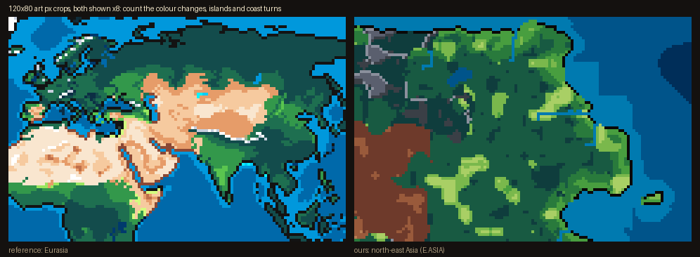
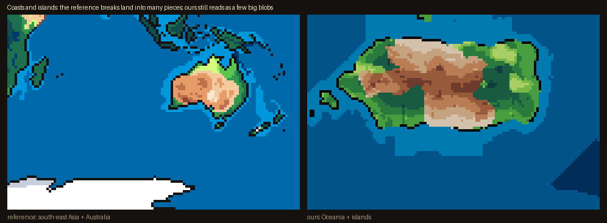
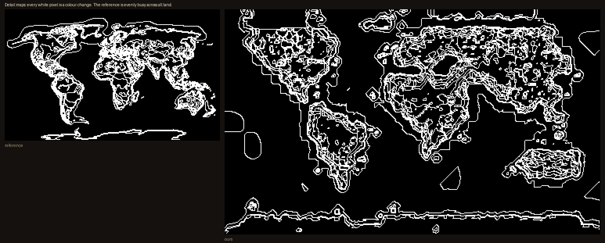
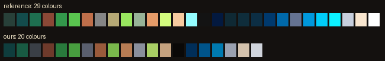

# World map: fidelity target sheet (v2, #112; replaces #98)

**Reference:** the director's "pixel earth" (`ffd5a215d5-pixel-earth.png` on the `ballast/targets` branch; "Match: World map").
**Compared with:** the base layer as the game paints it at 1440x900 after #109 and #110: 480x288 terrain pixels, each shown 2 screen pixels wide, terrain only.
**Status:** proposed. The director is asked to confirm it (see `.ballast/reports/t112.md`).

**Why v2:** the director's review of v1 was "Fidelity targets are way off, it's far too low detail low pixel density". v1 kept a 320x192 canvas and set targets by impression: outline yes, shelf yes, ramps yes. It never asked for the reference's **amount of detail per pixel**, and the map met v1 while still looking empty. v2 measures both maps with the same numbers (`tools/map_target_metrics.py`) and sets targets you can check.


## The core problem, in one picture



The two crops are the same size: 120x80 terrain pixels, both at the same zoom.
- **Reference:** a whole continent fits in the frame. Coasts turn every 2-3 pixels, there are dozens of islands, and colours change every 3-4 pixels.
- **Ours:** the same frame shows one corner of one region. Our features are drawn 2-3 times larger per pixel: meadow blobs 6-10 pixels across, coasts that run straight for 8+ pixels, and few islands.

So making the map bigger (#109) added pixels but not density. **Detail must be specified per pixel, not per map.**





## Targets (measured; all in terrain pixels)

| # | Measure | Reference | Ours now (#110) | **Target** | Met? |
|---|---|---|---|---|---|
| 1 | Terrain resolution in game | 275x168 | 480x288 at 1440x900; 640x384 at 1920x1080 | **at least 480x288 at 1440x900**, scaling with the screen | yes |
| 2 | Screen pixels per terrain pixel | 2 | 2 | **2** (never 3 or more: that is what made v1 look low density) | yes |
| 3 | Map size on a 1440x900 screen | 550x336 | 960x576 | **at least 960 px wide** | yes |
| 4 | Colour changes per 100 neighbouring pixel pairs, whole map | 13.7 | 10.4 | **at least 13.5** | no |
| 5 | Same, on land only | 20.6 | 21.4 | **at least 20** | yes |
| 6 | Mean run of one colour along a land row | 3.5 px | 4.3 px | **3.5 px or less** | no |
| 7 | Coast wiggle: coast length ÷ the perimeter of one round blob of the same land area | 6.4 | 3.9 | **at least 6** | no |
| 8 | Islands: land pieces under 0.2% of the map, per 10,000 pixels | 36 | 7 | **at least 25**, clustered into archipelagos, never evenly sprinkled | no |
| 9 | Distinct colours | 29 | 20 | **28-32**, extending `MAP_PALETTE` (see below) | no |
| 10 | Coast pixels carrying the dark outline | 63% | 61% | **60-75%** | yes |
| 11 | Land share of the map | 24% | 28% | 22-30% (keep: the layout sets it) | yes |

Run the checks with:
```
node tools/export-map-base.mjs --scale 1.5 /tmp/ours.png
python3 -I tools/map_target_metrics.py <reference.png> /tmp/ours.png
```
This writes `metrics.json` and these images.

## What that means for the painter (the next art pass)

- **Feature size, not map size.** The fine texture, coast noise and meadow and forest blobs must be sized in terrain pixels:
  - most texture clusters 2-4 px across;
  - coast turns every 2-3 px;
  - no straight coast run longer than about 6 px.
  
  Today several of these are sized in map units, so they grow with the map; that is why #109 added pixels but not detail.
- **Coasts:** many more inlets, peninsulas and fjords. Peninsulas 2-4 px wide and 8-20 px long, the reference's Scandinavia, Italy and Korea kind. Gulfs and inland seas cut into every continent.
- **Islands:**
  - archipelagos of 5-30 islands each, 1-6 px across;
  - island arcs off at least 4 of the 8 regions;
  - an island-strewn polar edge, like the reference's Arctic.
- **Land bands:** biome bands as long, thin, nested shapes, not round blobs. Mountain spines and river valleys run across continents, and colour changes every 3-4 px on average.
- **Palette (target 9):** add 8-10 colours to `MAP_PALETTE`:
  - a 4th and 5th ocean blue, for shelf breaks and the deep edge;
  - two more greens (a yellow-green and a blue-green);
  - two lighter sands;
  - a cold grey-blue for tundra;
  - a highlight white for the caps.
  
  Keep the 1 px K outline and the flat open ocean.
- **Keep:** crisis overlays, heat, borders and labels must stay readable (the crisis check, 32/32 today). Hit areas and the region layout do not change.



## Must not change (so the game keeps working)

- The 40x24 region hit grid (`MAP_REGIONS`, `regionAt`) and the region layout. Terrain resolution is free; hit areas are not.
- Overlays (borders, heat, cities, pins, labels) draw on top at a whole-number zoom and stay readable at 1280, 1440 and 1920.
- Regions are fictional with real echoes (GDD World canvas). Match the reference's **fidelity**, not its real-world geography.

## Acceptance for the next art pass

1. Targets 4, 6, 7, 8 and 9 are met at 1440x900 (480x288 terrain), measured with `tools/map_target_metrics.py`.
2. Targets 1-3, 5, 10 and 11 still hold.
3. `node --test tests/*.test.js`, `tools/map-crisis-check.cjs` (32/32) and `tools/map-ingame-check.cjs` all pass.
4. A side-by-side at the same pixel density (as in image 01) goes to the director for sign-off. Passing the numbers is necessary, not sufficient.
