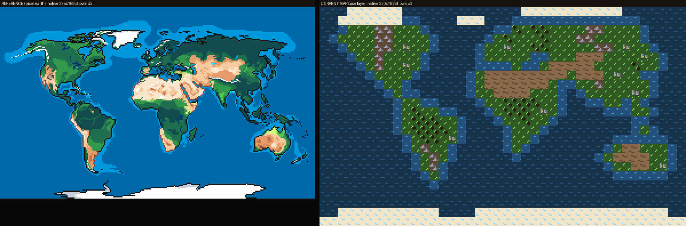
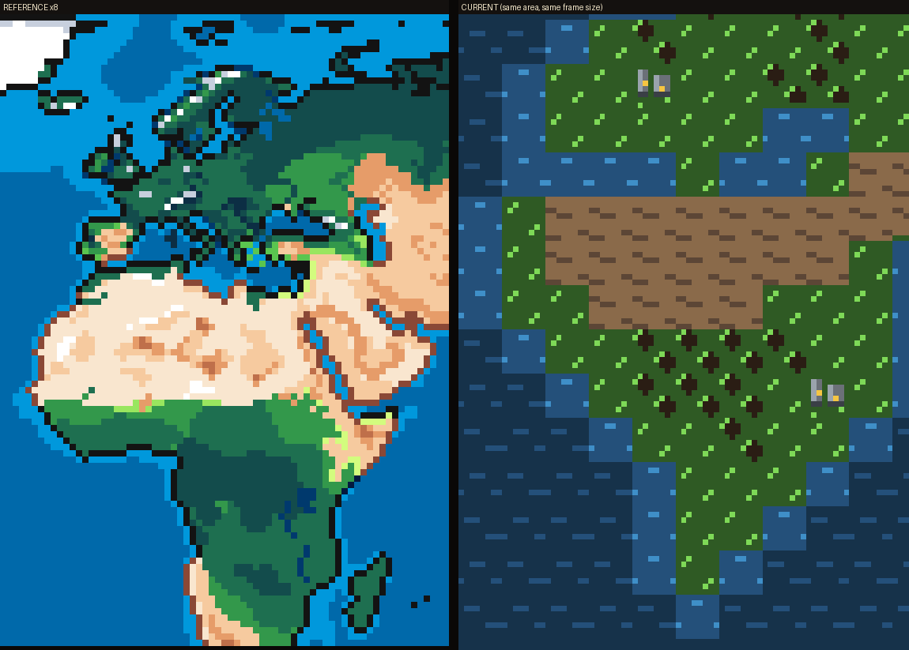
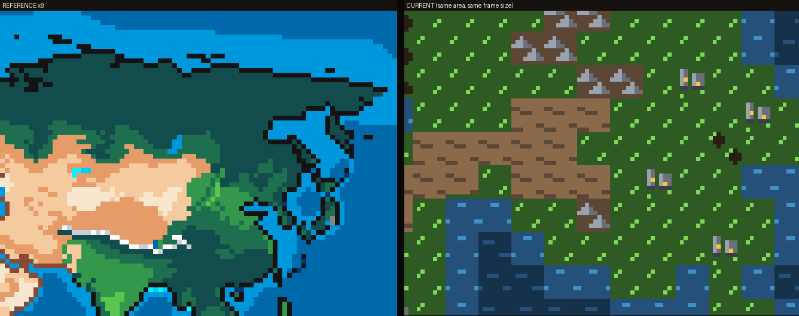
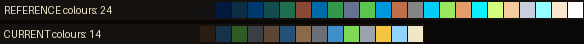

# World map: fidelity target sheet (#98, Art note D3)

**Reference:** the director's "pixel earth" (`ffd5a215d5-pixel-earth.png` on the `ballast/targets` branch; "Match: World map").
**Compared with:** the current base layer (`src/art/worldmap.js`, terrain only, no overlays or labels).
**Status:** proposed. The director is asked to confirm it (see `.ballast/reports/t98.md`). #99 turns it into style-guide rules; #100 repaints the base layer to it.

| Zoomed crop: Europe and Africa | Zoomed crop: northern coasts |
|---|---|
|  |  |

## What differs

| | Reference (measured) | Current map | Target for the redo |
|---|---|---|---|
| **Resolution / scale** | Drawn at 2x: 275x168 art pixels, every pixel placed by hand | 320x192 canvas, but terrain is 8x8 tiles: only 40x24 terrain cells | Keep the 320x192 canvas and 2x+ integer display. Paint terrain **per pixel**; the 8px cell grid stays only as the invisible hit grid for regions. |
| **Coastlines** | Organic, 1px steps, inlets, peninsulas, scattered 1-3px islands | 8px staircase; every coast is a run of square steps | Hand-shaped 1px coasts that follow the current region shapes; at least one inlet or peninsula per region edge; small islands allowed. |
| **Outline treatment** | 77% of coast pixels are a near-black 1px outline (#131313), on the land side, broken in places | No outline: land meets water by colour only | 1px dark outline on the land side of every coast, deliberately broken (about a quarter of the coast left open) so it reads as drawn, not traced. Never outline region borders inside land. |
| **Ocean** | Two flat blues: deep (#0069AA) and a shallow shelf (#0098DC) hugging coasts, median 2px, up to ~10px off big coasts; no wave texture | Dark navy with a repeating wave tick on every tile; a lighter 8px tile ring for shelf | Flat deep ocean, no tiled waves. A shallow shelf band 2-4px wide along coasts, wider (6-10px) off large landmasses and between close islands. |
| **Palette depth** | 24 colours in all: 8 ocean/ice blues, 16 land tones in clear ramps (3-4 greens, a 5-step sand-to-rust ramp, white and blue-grey snow) | 14 colours, most from the general UI palette; 3 land tones carry the whole map | 20-28 map colours in ramps: ocean 3-4, forest/grass 4, desert 4-5, mountain/rock 3, snow 2, plus the outline. Extend the 28-colour game palette rather than replace it (#99 defines it). |
| **Shading** | Elevation and biome bands drawn as nested blobs: dark forest cores inside lighter grass, sand ramps darkening toward mountain spines; no light source shading | Flat fills, with a dark brown tile for mountains | Biome bands as nested blobs with a 3-4 step ramp each. Optional light from the top-left: one-pixel highlight on mountain ridges only. |
| **Terrain texture** | Clusters, not noise: shapes of 3+ pixels of one colour; no dithering; occasional single-pixel lakes and rivers | A repeated tile pattern (the same grass tick and tree in every cell) makes a visible grid | No repeating tile pattern anywhere. Clusters of at least 3 pixels; no checkerboard dithering on land; a few 1px lakes and river lines in green regions. |
| **Detail density** | High along coasts and mountain spines, calm in deserts and open ocean | Uniform: every land cell is equally busy | Put detail where the eye goes: coasts, mountain spines, polar edges. Keep big deserts and the open ocean calm so crisis overlays and pins read on top. |
| **Ice** | White caps with a blue-grey (#C7CFDD) shaded edge along top and bottom, ragged edge | Flat cream rectangles along the top and bottom edge | Ragged polar caps, white with a 1px blue-grey shadow edge, one or two ice floes. |
| **Overall value** | Bright, daylight atlas | Dark, muted war-room | See the open question: brighter land and ocean as in the reference, with the war-room mood carried by the crisis overlays and UI frame (proposed), or the reference's detail at today's darker values. |

## Must not change (so the game keeps working)

- Canvas size 320x192 and the 40x24 grid of 8px cells the region hit areas use (`MAP_REGIONS`, `regionAt`).
- Region layout: the same regions in the same places (#100 keeps the layout; only how it is painted changes).
- Crisis overlays, icons, buyer and bunker pins, labels: they draw on top of the base layer and must stay readable on it.
- Regions are fictional with real echoes (GDD World canvas): match the reference's fidelity, not its real-world geography.

## Acceptance checks for the redo (#100)

1. No two horizontally or vertically adjacent 8x8 cells of the same terrain look identical (no tile repeat).
2. At least 75% of coast pixels on the land side carry the outline colour; the remainder are deliberate gaps.
3. Shallow shelf present on every coast; deep ocean has no texture.
4. 20-28 distinct colours in the base layer; every land biome uses at least 3 tones.
5. Hit areas unchanged: clicking each region on the new layer selects the same region as today.
6. Crisis overlays and pins still readable at 1x and 2x (checked with a screenshot at the Brink).
